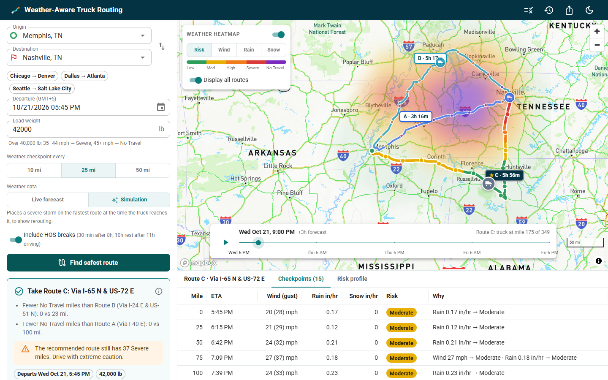

# Weather-Aware Truck Routing

A React + Django app that helps a truck driver pick the safest of three routes. It weighs forecast weather at the time the truck reaches each point, the load weight, and travel time.

**Live app:** _TBD_ · **API:** _TBD_ · **Walkthrough (Loom):** _TBD_



---

## What it does

1. The driver enters an **origin, destination, departure time and load weight**, and picks a checkpoint interval (**10 / 25 / 50 mi**).
2. The backend gets **3 truck routes** from TomTom. They use the truck profile with gross vehicle weight and are traffic-aware for the departure time.
3. Each route is sampled every N miles. Each checkpoint gets an **ETA from TomTom's own per-point travel times**, plus optional **HOS rest breaks**.
4. The weather at **each checkpoint's ETA** (not at departure) is scored with the spec's **risk table and load rules**.
5. Routes are ranked: **fewest Severe miles → fewest High miles → lowest average risk → shortest travel time**. The UI explains *why* the winner won.
6. The map shows **all routes, checkpoints, risk levels, ETAs and route summaries**, plus a **weather heatmap along the corridor** with a **0–48 h forecast slider**. Trucks move along their routes as you scrub or press play.

A **Simulation** mode puts a severe storm on the fastest route at the time the truck reaches it. Real weather is usually calm, so this lets you see rerouting, load rules and the heatmap working on demand. Integration tests use it too, so they are deterministic.

## How the logic works

```
TomTom (truck, 3 routes) ──► sample every N mi ──► ETA per checkpoint ──► Open-Meteo hourly forecast at ETA
                                                   (TomTom progress            │
                                                    + HOS stops)               ▼
         recommendation ◄── rank routes ◄── miles per risk level ◄── risk per checkpoint (table + load rules)
```

All rules are **pure Python** in `backend/planner/domain/` (no I/O), with exhaustive unit tests:

| Module | Responsibility |
|---|---|
| `risk.py` | Threshold table, load rules, worst-of combination, human-readable "why" factors |
| `geometry.py` | Haversine, checkpoint sampling, Douglas–Peucker simplification, duplicate-route detection |
| `timing.py` | Distance → driving time (provider progress); driving → wall-clock time (HOS) |
| `weather.py` | Forecast lookup at an exact time (wind interpolated; precip from the correct hour window) |
| `ranking.py` | Mile-weighted aggregation and the recommendation ordering |

### Interpretation decisions (where the spec is ambiguous)

| Question | Decision | Why |
|---|---|---|
| Shared range endpoints (rain 0.25 is in both "0.10–0.25" and "0.25–0.50") | **Lower bound inclusive**: 0.25 → High | Conservative for a safety tool. Explicit operators are kept literally: wind **≥55** = No Travel; rain **>1.00** and snow **>3.0** (so exactly 1.00 in/hr rain is Severe). |
| Overall checkpoint risk | **Worst of** wind (after load rules), rain, snow | One dangerous factor is enough to make a stretch dangerous. |
| Load rules | Only ever **raise** the wind level; the >30,000 lb / >40,000 lb thresholds are strict | Matches "> N lb". 35–44 mph + 40,001 lb → Severe; 45–54 mph + 30,001 lb → No Travel. |
| "Severe miles" | Each checkpoint represents the road **halfway to its neighbours**; the segments tile the route exactly | Miles add up to the route length at every interval. |
| No Travel in the ranking | Compared **before** Severe miles | Otherwise 5 No Travel miles would beat 6 Severe miles. |
| "Lowest average risk" | Mile-weighted score (Low 0 … No Travel 4), compared at **0.1 resolution** | Exact floats almost never tie, so travel time would never matter and the app would add hours of driving to dodge a few Moderate miles. The rounding is how the brief's "balance weather risk and travel time" is met. |
| Which wind | Sustained 10 m wind (gusts shown for context) | The table says wind speed; gusts would double-count. |
| Rain rate | Open-Meteo `rain + showers` (in/hr) | Convective showers are rain too. |
| Time alignment | Wind interpolated between hours; precipitation taken from the hour window that contains the ETA | Open-Meteo precip is the total of the *preceding* hour. |
| Load weight vs vehicle weight | Cargo weight for the rules; cargo + 35,000 lb tare sent to TomTom as gross weight | TomTom applies weight restrictions using gross weight. |
| HOS (optional, on by default) | 30 min break after 8 h driving; 10 h rest after 11 h | On a 30 h haul this moves ETAs by 20+ hours, which changes the weather the truck meets. |

## Map and heatmap performance

The heatmap is designed so the **slider never touches the network**:

- **Corridor grid.** The backend builds a grid **only along a 45 mi buffer around the routes**. The cell size adapts to trip length so any trip stays under 320 forecast points, which fits within Open-Meteo's free quota. The grid is square in **Web Mercator**, so it maps exactly onto an image overlay.
- **One request.** All **49 hourly frames** (0–48 h) come back in one compact response, and risk is pre-computed with the trip's load weight.
- **Pre-rendered frames.** The client paints each frame once: one pixel per cell, upscaled 8× through a blur. The frames are stacked as GPU raster layers, and scrubbing only changes **two layers' opacity**, so the paint transition crossfades between hours. Playback uses `requestAnimationFrame`, so the trucks glide.
- **Fast first paint.** Routes render immediately and the heatmap loads lazily into the plan row, cached there.
- **Less to draw.** Route geometry is simplified server-side to ≤1,500 vertices.
- **Smaller bundle.** The Data Grid, Charts and the rules dialog are lazy-loaded, and the GL engine is its own cached chunk.
- **Fewer re-renders.** UI state is split so the 60 fps forecast clock re-renders only the map overlays, not the side panel.
- **Weather caching.** Forecast points snap to a 0.05° lattice, which is finer than the 3 km HRRR model. Each point is cached with a fixed forecast window starting at the current hour, so any plan at any departure time reuses it, and overlapping routes and repeat trips share points.
- **Route and geocode caching.** TomTom alternatives take about 4 s to compute on long trips, so identical route requests within the same departure hour are cached for 10 minutes; a repeat plan then takes under 1 s. Geocoding is cached for 24 h.
- **Rate-limit budget.** Open-Meteo's free tier allows 600 calls per minute and counts *every location* as a call. A per-minute budget shared across workers (kept in Redis) holds requests until the next minute instead of failing, and a 429 is retried once. The UI explains the wait if one happens.

## Stack (and why)

Chosen to match the stack Spotter's own product uses:

| Layer | Choice |
|---|---|
| Frontend | React 18 + TypeScript, Vite, **MUI** (`sx` styling, light/dark theme), **MUI X Data Grid / Charts / Date Pickers** |
| Data fetching / state | **TanStack React Query** for server state; **Context + `useReducer`** for UI state |
| Forms | **Formik + Yup**, mirroring server-side validation |
| Map | **react-map-gl** with **Mapbox GL** (`navigation-day/night` styles) when `VITE_MAPBOX_TOKEN` is set. With no token it falls back to **MapLibre** and OpenFreeMap tiles through the same components, switched by a build-time alias, so it runs without any map account. |
| Backend | **Django 5.2 LTS + DRF**, ViewSets + routers under a versioned `/api/v1/`, **PostgreSQL**, **Redis** cache, scoped throttling to protect API quotas |
| Providers | TomTom Routing (truck) + Search, Open-Meteo forecast. Each sits behind a small `Protocol`, so the planner never imports a vendor client. |
| Ops | Docker + docker-compose (Postgres, Redis, API, web), Render blueprint, Vercel, GitHub Actions CI |

## API

| Method | Path | Purpose |
|---|---|---|
| `POST` | `/api/v1/trip-plans/` | Compute and store a plan (routes, checkpoints, risk, recommendation) |
| `GET` | `/api/v1/trip-plans/{id}/` | Fetch a stored plan (shareable `?plan=` links) |
| `GET` | `/api/v1/trip-plans/{id}/heatmap/` | 0–48 h corridor grid, computed on first request and cached |
| `GET` | `/api/v1/trip-plans/` | 10 most recent plans |
| `GET` | `/api/v1/geocode/?q=` | Place search (TomTom, cached) |
| `GET` | `/api/v1/risk-rules/` | The thresholds the backend applies (drives the UI's rules dialog) |
| `GET` | `/api/v1/health/` | Liveness + whether routing is configured |

Example request:

```json
POST /api/v1/trip-plans/
{
  "origin": { "label": "Chicago, IL", "lat": 41.8781, "lon": -87.6298 },
  "destination": { "label": "Denver, CO", "lat": 39.7392, "lon": -104.9903 },
  "departure_time": "2026-10-22T14:00:00Z",
  "load_weight_lbs": 42000,
  "sample_interval_miles": 25,
  "weather_source": "live",
  "include_hos": true
}
```

## Running locally

Prerequisites: Python 3.10+, Node 20+, and a free [TomTom key](https://developer.tomtom.com) (no card needed).

```bash
# Backend
cd backend
python -m venv .venv && source .venv/bin/activate   # Windows: .venv\Scripts\activate
pip install -r requirements-dev.txt
cp .env.example .env                                  # set TOMTOM_API_KEY
python manage.py migrate
python manage.py runserver                            # http://127.0.0.1:8000/api/v1/health/

# Frontend (new terminal)
cd frontend
npm install
cp .env.example .env                                  # optional: VITE_MAPBOX_TOKEN
npm run dev                                           # http://localhost:5173 (proxies /api → :8000)
```

Or run the whole stack with Docker: `docker compose up --build` → http://localhost:5173

## Tests and quality

```bash
cd backend  && pytest && ruff check . && ruff format --check .
cd frontend && npm test && npm run lint && npm run build
```

- **Backend: 108 tests.** These cover every threshold boundary and load rule, checkpoint tiling at 10/25/50 mi, HOS wall-clock math, forecast time alignment, each ranking criterion, TomTom request parameters and response parsing (including the fallback strategies used when TomTom returns fewer than 3 alternatives), Open-Meteo batching, caching, rate budget and 429 retry, route caching, the simulated storm rerouting the recommendation, the heatmap grid budget, and the API (validation, error mapping, heatmap caching).
- **Frontend:** unit tests for time and mile interpolation along the path, and for the color scales.
- **CI:** GitHub Actions runs everything above on every push.

## Deployment

- **API: Render.** `render.yaml` provisions the web service, Postgres and Key Value (Redis). Set `TOMTOM_API_KEY` and `CORS_ALLOWED_ORIGINS` in the dashboard.
- **Web: Vercel.** Set the root directory to `frontend` and set `VITE_API_BASE_URL=https://<api>.onrender.com`. `VITE_MAPBOX_TOKEN` is optional.
- Render's free tier sleeps when idle. The UI shows a "waking up the server" notice if the first request is slow.
- The Dockerfile is production-ready, so the same image deploys to **GCP Cloud Run** with Cloud SQL and Memorystore unchanged. Only the env vars differ.

## Limitations and next steps

- **Celery for long trips.** Heatmap and plan computation take about 1 s each, so they run inline. At higher volume they would move to Celery workers with a task-status endpoint.
- **Hourly forecast resolution.** Precipitation is an hourly total, so short, intense bursts are averaged out.
- **Simplified HOS.** The model covers the 8 h break and the 11 h driving limit, but not the 14 h window or the 70 h/8-day cycle.
- **Fixed truck dimensions.** Length, height and hazmat class are fixed; TomTom supports them, so they could become form fields.
- **Gusts and WMO weather codes** (e.g. freezing rain, thunderstorms) are shown but not scored, because the brief defines risk only by wind, rain and snow.
